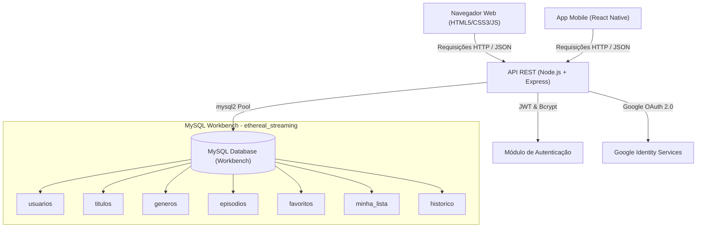

# 🎬 ETHEREAL Streaming (Ethereal X) — Documentação Oficial do TCC

> **Projeto de Conclusão de Curso (TCC 2026)**  
> **Tema:** Plataforma de Streaming de Filmes e Séries com Interface Futurista e Autenticação Integrada.  
> **Status:** Código implementado, banco de dados modelado e telas alinhadas aos mockups oficiais.

---

## 1. Identificação do Projeto
- **Nome Oficial:** ETHEREAL Streaming (*identidade de marca na interface: Ethereal X*)
- **Tipo de Projeto:** Aplicação Web e Mobile para disponibilização, reprodução, pesquisa e gerenciamento personalizado de conteúdos audiovisuais (filmes e séries).
- **Público-Alvo:** Usuários que buscam uma experiência de streaming moderna, imersiva, organizada por categorias e com personalização de listas e histórico.

---

## 2. Objetivo Geral e Específicos

### Objetivo Geral
Desenvolver uma plataforma de streaming completa, intuitiva e de alta performance, unindo um design visual com estética *cyberpunk/futurista neon* a uma arquitetura modular, escalável e segura.

### Objetivos Específicos
1. **Catálogo e Navegação:** Permitir que o usuário explore filmes, séries e episódios organizados por categorias e carrosséis dinâmicos ("Em alta", "Tendências").
2. **Busca Instantânea:** Implementar busca em tempo real com técnica de *debounce* por títulos, gêneros e sinopses.
3. **Player de Vídeo Real:** Disponibilizar player HTML5 funcional com controles nativos, gravação de progresso em segundos e retomada automática.
4. **Personalização do Usuário:** Oferecer sistemas independentes de **Favoritos** (marcação rápida), **Minha Lista** (conteúdos para assistir depois) e **Histórico** (gravação contínua do progresso).
5. **Autenticação Segura:** Login e cadastro via e-mail e senha criptografada (bcrypt + JWT), além de integração com **Google OAuth 2.0**.
6. **Configurações e Perfil:** Gerenciamento de preferências do usuário (autoplay, qualidade padrão de vídeo, legendas, notificações e edição de dados cadastrais).

---

## 3. Matriz Tecnológica e Alinhamento Técnico

> [!IMPORTANT]
> ### ⚠️ Ajuste Técnico Essencial para a Banca Examinadora do TCC
> Em bancas acadêmicas de Ciência da Computação, Sistemas de Informação e Engenharia de Software, **a precisão da stack tecnológica é rigorosamente avaliada**. Abaixo está o posicionamento correto de cada tecnologia:

| Camada | Tecnologia Oficial | Função no Projeto | Justificativa Técnica para a Banca |
|---|---|---|---|
| **Front-end Web** | **React.js (SPA) + Vite** | Arquitetura baseada em componentes reativos, gerenciamento de estado global (AuthContext/ToastContext), roteamento SPA dinâmico (React Router) e player `<video>`. | Padrão moderno da indústria para Single Page Applications (SPA) de alta escalabilidade e reatividade. |
| **Estilização** | **Tailwind CSS + Design System Custom** | Utilitários de estilização atômica, Glassmorphism, temas neon (`#7B2FF7`, `#0B0B0B`), animações de hover e responsividade completa. | Produtividade, consistência visual, ausência de dead code no bundle final e máxima fidelidade ao design Canva. |
| **Front-end Core** | **JavaScript Moderno (ES6+)** | Consumo assíncrono de API REST (`fetch`), debounce na busca e interatividade do logotipo (olho SVG que rastreia o cursor). | Padrão robusto e tipável para aplicações Web contemporâneas. |
| **Back-end API** | **Node.js + Express** | Servidor HTTP, criação de rotas RESTful, middlewares de autenticação JWT e CORS. | Modelo assíncrono não-bloqueante (I/O intensivo), ideal para serviços de streaming. |
| **Autenticação** | **JWT + Passport.js + Google OAuth 2.0** | Emissão de tokens de acesso seguros e login social federado. | Padrão da indústria para segurança stateless e OAuth 2.0. |
| **Serviço de E-mail** | **Nodemailer + SMTP (Gmail TLS)** | Envio automatizado de e-mails de recuperação de senha com tokens de 30min, códigos de verificação e geração de credenciais seguras pelo backend. | Comunicação assíncrona com templates HTML responsivos personalizados. |
| **Banco de Dados** | **MySQL + MySQL Workbench** | Modelagem relacional, integridade referencial com chaves estrangeiras (`ON DELETE CASCADE`) e persistência. | SGBD relacional robusto, estruturado em 3ª Forma Normal (3FN). |
| **Mobile (Extensão)** | **React Native + Tailwind CSS (NativeWind)** | Versão para dispositivos móveis (Android e iOS). | Código compartilhado multiplataforma consumindo a mesma API REST do Node.js. |
| **Módulo Python (Auxiliar)** | **Python (FastAPI / Scripts ETL)** | *Ver detalhes abaixo*. | Processamento de dados de recomendação ou carga automatizada do catálogo via APIs externas. |

### 💡 Como justificar o "Python" perante a Banca:
Navegadores web **não executam Python nativamente** no cliente. Portanto, você pode apresentar o Python de uma das seguintes formas legítimas:
- **Opção A (Módulo Inteligente de Recomendação — Recomendada):** Python é utilizado como um microserviço ou módulo analítico (ex.: script com algoritmo de similaridade por cosseno ou filtragem baseada em conteúdo) que processa as preferências e o histórico do usuário no MySQL para gerar recomendações personalizadas.
- **Opção B (Script de Automação e Carga de Catálogo):** Python atua como script utilitário de *Web Scraping* ou ETL consumindo APIs de cinema (como TMDB/IMDb) e gerando o arquivo `seed.sql` do banco.
- **Opção C (Stack Web Pura):** Caso seu curso não exija Python obrigatoriamente, retire o Python do slide de Front-end e apresente a tríade nativa **HTML5 / CSS3 / JavaScript** no Front-end e **Node.js / Express** no Back-end. A banca valorizará muito a clareza e coerência dessa decisão.

---

## 4. Identidade Visual e UI/UX

A estética do ETHEREAL Streaming baseia-se no conceito **Cyberpunk Glass Neon**:
- **Preto Profundo (`#0B0B0B` / `#07040d`):** Fundo imersivo com gradientes radiais simulando profundidade espacial.
- **Roxo Neon Elétrico (`#7B2FF7`):** Destaque principal, bordas ativas, botões de ação e contorno pulsante.
- **Branco Puro (`#FFFFFF`):** Textos de alto contraste e legibilidade.
- **Glassmorphism:** Efeito vidro fosco (`backdrop-filter: blur(18px)`) em cards, menus e modais.
- **Logotipo Interativo (Olho Ethereal):** SVG vetorial cuja pupila em espiral acompanha o movimento do mouse na tela (`mousemove`) e pisca automaticamente em intervalos aleatórios entre 3s e 7s (`scaleY`).

---

## 5. Mapeamento de Telas x Protótipos

| Tela | Componente / Rota React | Componentes Principais | Alinhamento com o Protótipo |
|---|---|---|---|
| **Login (Inicial)** | `LoginPage.jsx` (`/`, `/login`) | Card com borda roxa neon (`#7B2FF7`), inputs ovais em pílula, alternador de senha, "Esqueceu sua senha?", botão "Entrar" vazado e login com Google. É a **página inicial** da aplicação. | 100% idêntico ao slide do Canva. |
| **Início** | `HomePage.jsx` (`/home`) | Topbar com busca e avatar, banner de destaque (**South Park**), carrosséis "Em alta" e "Tendências" com rolagem lateral e botão "Ver todos". | 100% idêntico ao slide do Canva. |
| **Gêneros** | `GenresPage.jsx` (`/genres`) | Grade com 11 cards com suas cores características (Ação, Aventura, Comédia, Drama, Fantasia, Ficção científica, Mistério, Romance, Suspense, Terror, Documentário). | 100% idêntico ao slide do Canva. |
| **Favoritos** | `FavoritesPage.jsx` (`/favorites`) | Grade de títulos favoritados pelo usuário, cada um com o selo de coração vermelho (`❤️`) sobreposto no canto superior direito do poster. | 100% idêntico ao slide do Canva. |
| **Filmes / Séries** | `MoviesPage.jsx`, `SeriesPage.jsx` | Catálogo filtrável por gênero dinâmico, ordenação e pesquisa instantânea. | Completo e integrado à API. |
| **Minha Lista** | `MyListPage.jsx` (`/mylist`) | Títulos marcados para assistir mais tarde com selo de marcador (`🔖`). | Integrado ao banco de dados. |
| **Histórico** | `HistoryPage.jsx` (`/history`) | Lista de conteúdos com barra de progresso em porcentagem ("Continue assistindo"). | Salva tempo exato via API. |
| **Configurações** | `SettingsPage.jsx` (`/settings`) | Edição de nome/e-mail, alteração de senha, toggles de reprodução automática e seleção de qualidade de vídeo. | Totalmente funcional. |
| **Esqueci Minha Senha** | `EsqueciSenhaPage.jsx` (`/esqueci-senha`) | Solicitação de link/código por e-mail ou geração direta de nova senha forte pelo backend com envio por e-mail. | Estilo cyberpunk fiel. |
| **Redefinir Senha** | `RedefinirSenhaPage.jsx` (`/redefinir-senha`) | Validação de token ou código de 6 dígitos recebido por e-mail, criação e confirmação da nova senha com hash bcrypt. | Integrado com Nodemailer. |
| **Player / Detalhes**| `DetailPage.jsx` (`/detail/:id`) | Player `<video>` HTML5 real, sinopse, classificação, elenco, lista de episódios (para séries) e botões de favoritar. | Player com vídeos livres. |

---

## 6. Arquitetura do Sistema e Fluxo de Dados



---

## 7. Estrutura do Banco de Dados (DER)

- **`usuarios`**: Guarda credenciais (senha com hash bcrypt ou ID do Google), preferências de reprodução e dados do perfil.
- **`generos`**: Categorias de conteúdo com nome e slug identificador.
- **`titulos`**: Catálogo único polimórfico (`filme` ou `serie`), com título, sinopse, ano, classificação, nota, poster vertical, banner horizontal e URL de vídeo (para filmes).
- **`titulo_genero`**: Tabela associativa N:N ligando títulos a múltiplos gêneros.
- **`episodios`**: Episódios vinculados a séries, organizados por temporada e número do episódio, com link direto de streaming.
- **`favoritos`**: Relação N:N entre usuários e títulos marcados com coração.
- **`minha_lista`**: Relação N:N entre usuários e títulos salvos para assistir posteriormente.
- **`historico`**: Registra o progresso de reprodução em segundos (`progresso_segundos` / `duracao_segundos`), permitindo continuar exatamente de onde parou.

---

## 8. Guia Rápido de Execução para a Apresentação

### 1. Iniciar o Banco de Dados
No **MySQL Workbench**:
1. Conecte ao seu servidor local (usuário `root`).
2. Abra e execute `backend/database/schema.sql` (cria tabelas e relacionamentos).
3. Abra e execute `backend/database/seed.sql` (insere os gêneros, séries como South Park, filmes em alta e tendências idênticos aos slides).

### 2. Iniciar o Backend
Abra um terminal no diretório `backend`:
```bash
npm install
npm run dev
```
O console exibirá:
```text
✅ Conectado ao MySQL com sucesso!
🟣 Ethereal X rodando em http://localhost:3000
```

### 3. Iniciar o Frontend (React.js + Tailwind CSS)
Abra um terminal no diretório `frontend`:
```bash
npm install
npm run dev
```
Ou execute tudo junto a partir da raiz do projeto:
```bash
npm run dev
```
- O frontend será iniciado em `http://localhost:5173`.
- A rota raiz (`/`) direciona diretamente para a **página de login**, idêntica ao design do Canva, com proteção de rotas ativada para acesso ao restante da plataforma após autenticação.
